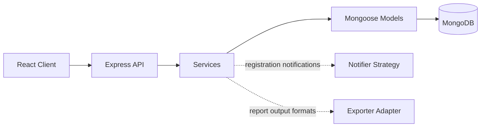

# CampusEvents (MERN)

CampusEvents helps a university community publish events, manage registrations, and report attendance.

## Modules

- Authentication and role-based access
- Event creation and discovery
- Event registration, capacity, and waitlists
- Email/SMS notification strategies
- Attendance reporting and CSV export

## Architecture



The registration service uses a notifier strategy; the report controller plugs an exporter adapter into report output.

## Design Patterns

| Pattern | Category | Where | Problem solved | Rejected alternative |
|---|---|---|---|---|
| Singleton | Creational | `server/src/config/db.js` | Shares one MongoDB connection across the server process. | Per-request connections waste resources and add connection overhead. |
| Strategy | Behavioral | `server/src/services/notifier/` | Switches notification channels without changing registration logic. | An `if/else` chain in the service violates Open/Closed. |
| Adapter | Structural | `server/src/exporters/` | Supports multiple report output formats without changing report logic. | Hardcoding CSV in `reportService` couples reports to one format. |

## Setup

Server:

```bash
cd server
npm i
cp .env.example .env
```

Set `JWT_SECRET` in `.env`, start MongoDB, then run:

```bash
npm run dev
```

Client (in a second terminal):

```bash
cd client
npm i
npm run dev
```

## Tests

From the project root, run `cd server && npx jest --coverage`. Coverage enforces a global gate of **80% statements** and **70% branches**.

## CI

[](https://github.com/OWNER/REPOSITORY/actions/workflows/ci.yml)

GitHub Actions runs server tests with coverage and builds the client on pushes and pull requests.

## AI Assistance

GitHub Copilot was used for scaffolding, and every line was reviewed and modified by me.

## License

MIT
